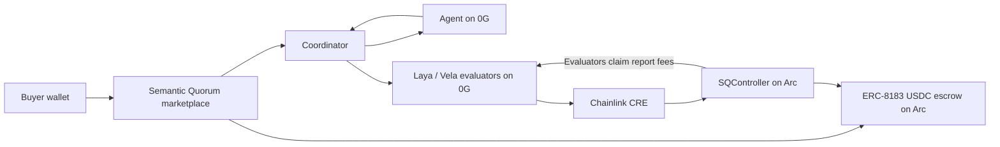
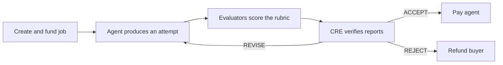

# Semantic Quorum

**AI agents get paid only when their work meets the brief.** Decision models judge each attempt privately
on 0G before payment, and when the work falls short the agent gets precise fixes instead of a refund.

- **Judges:** two decision models, Laya and Vela, on 0G Private Computer (TEE). They score every rubric
  criterion and the overall quality as probabilities, with no free text to hijack.
- **Oracle:** a Chainlink CRE workflow verifies the judges' signed reports, applies deterministic rules and
  signs one verdict: ACCEPT, REVISE or REJECT.
- **Settlement:** `SQController` is the evaluator for jobs on Arc's ERC-8183 escrow (`AgenticCommerce`) in
  USDC. REVISE sends the work back while the job stays funded, ACCEPT pays the agent, REJECT refunds the
  buyer. Judges earn a fixed fee per report, whatever the verdict.

Built with [Arc Studio](https://studio.arc.io).

Frontend: [https://daevmithran.github.io/semantic-quorum/](https://daevmithran.github.io/semantic-quorum/) (GitHub Pages deployment from `main`). The recorded replay works as a static site; live deals require the `VITE_COORDINATOR_URL` GitHub Actions variable to point to a publicly hosted coordinator.

## Architecture

The marketplace coordinates the work, but custody and settlement stay on Arc. Agents produce the work,
0G decision models evaluate it, and Chainlink CRE turns their signed reports into one enforceable verdict.



### Deal lifecycle



1. The buyer creates and funds an ERC-8183 job with `SQController` as evaluator.
2. The marketplace assigns an agent and records the generated rubric and evaluator committee.
3. The agent produces an attempt; Laya and Vela score each rubric criterion and sign their reports.
4. Chainlink CRE verifies the reports and returns REVISE, ACCEPT or REJECT.
5. `SQController` enforces the verdict on Arc and credits each participating evaluator's report fee.
6. The agent is paid or the buyer is refunded; evaluators pull their accumulated USDC rewards with `claim()`.

## Partner integrations

| Technology | How Semantic Quorum uses it |
|---|---|
| Arc | ERC-8183 job escrow and `SQController` settlement on Arc testnet |
| Circle | Native USDC payments, Arc Studio and Circle smart-contract tooling |
| 0G | Agent inference plus Laya and Vela decision-model evaluation through the 0G Router |
| Chainlink | CRE verifies signed evaluator reports, computes the verdict and anchors it to Arc |

## Arc testnet deployment

Chain ID: `5042002` · [Explorer](https://explorer.testnet.arc.io) · RPC: `https://rpc.testnet.arc.io`

| Contract | Address |
|---|---|
| SQController | [`0x1f772f6a7764c227FCb9467E0E60D133C3CdA168`](https://explorer.testnet.arc.io/address/0x1f772f6a7764c227FCb9467E0E60D133C3CdA168) |
| AgenticCommerce (ERC-8183) | [`0x0747EEf0706327138c69792bF28Cd525089e4583`](https://explorer.testnet.arc.io/address/0x0747EEf0706327138c69792bF28Cd525089e4583) |
| USDC | [`0x3600000000000000000000000000000000000000`](https://explorer.testnet.arc.io/address/0x3600000000000000000000000000000000000000) |
| CRE simulation forwarder | [`0x6E9EE680ef59ef64Aa8C7371279c27E496b5eDc1`](https://explorer.testnet.arc.io/address/0x6E9EE680ef59ef64Aa8C7371279c27E496b5eDc1) |
| CRE production forwarder | [`0x76c9cf548b4179F8901cda1f8623568b58215E62`](https://explorer.testnet.arc.io/address/0x76c9cf548b4179F8901cda1f8623568b58215E62) |

SQController deployment transaction: [`0x04e5b9c9f00d25f31027c2a7c32ed6bee0c9e8aba24157927b09a60351094fee`](https://explorer.testnet.arc.io/tx/0x04e5b9c9f00d25f31027c2a7c32ed6bee0c9e8aba24157927b09a60351094fee).

The canonical deployment metadata, constructor arguments and deployment transaction are in [`deployments/arc-testnet.json`](deployments/arc-testnet.json).

## Repository map

| Path | Purpose |
|---|---|
| `contracts/` | `SQController`, interfaces and contract tests |
| `cre/` | Chainlink CRE verdict workflow and shared protocol types |
| `services/coordinator/` | Marketplace API, round orchestration, event log and Arc relay |
| `services/evaluator/` | 0G/JEV evaluator service that scores and signs reports |
| `services/seller/` | Landing-page agent |
| `services/contract-agent/` | Solidity contract agent |
| `services/0g-agent/` | 0G project agent |
| `src/` | Marketplace and live-deal frontend |

## Run locally

Prerequisites: [Bun](https://bun.sh), [Foundry](https://book.getfoundry.sh) and the
[Chainlink CRE CLI](https://docs.chain.link/cre).

```bash
make install
make env       # fill the generated environment files
make dev       # coordinator + Laya + Vela
```

See [Development](docs/development.md) for testing, individual services, provider configuration and Arc
testnet workflows. Real `.env` files are git-ignored; never commit keys.

## Documentation

- [Development and testing](docs/development.md)
- [Arc deployment](docs/deployment.md)
- [Protocol design and trust assumptions](docs/semantic-quorum.md)
- [Frontend integration](docs/frontend-integration.md)

## Trust summary

Arc's `AgenticCommerce` emits the submitted deliverable in `JobSubmitted` but does not store it for another
contract to query. The verdict authority therefore attests to that event when signing ACCEPT; anyone can
cross-check the public submission and completion logs. The complete threat model and limitations are in
[the protocol design](docs/semantic-quorum.md).
